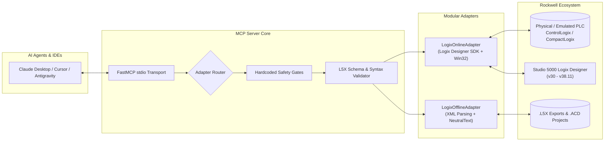
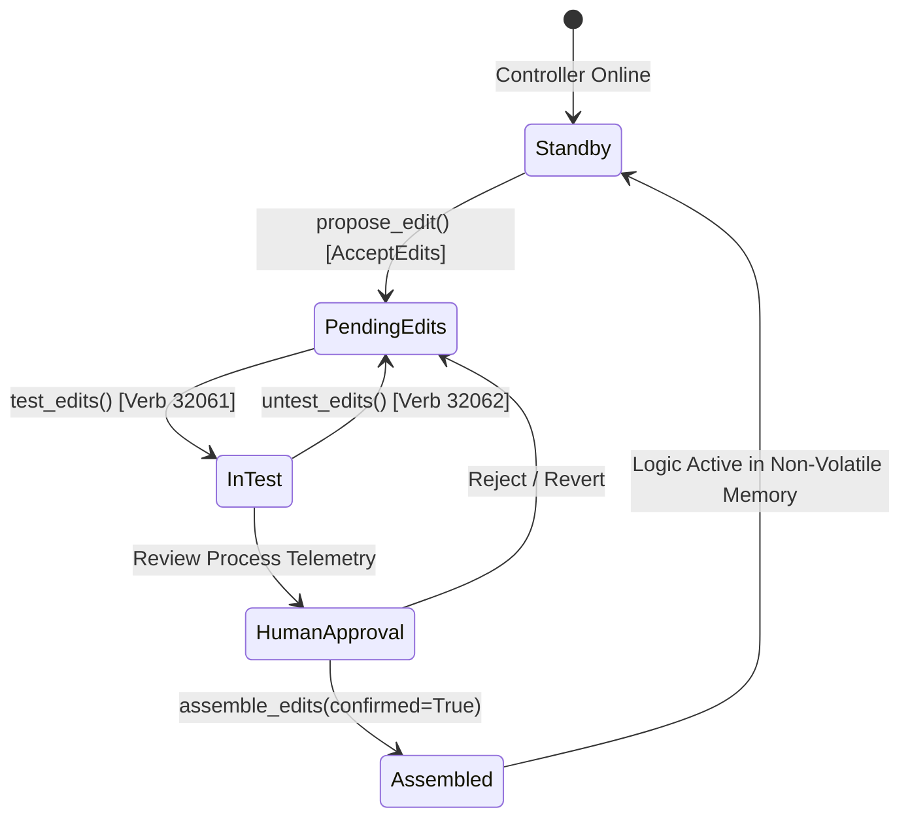

# Studio 5000 Live & Offline MCP Server

[](https://github.com/krusailor44-afk/studio5000-live-mcp/actions/workflows/ci.yml)
[](https://www.python.org/downloads/)
[-red.svg)](https://www.rockwellautomation.com/)
[](https://modelcontextprotocol.io/)
[](https://opensource.org/licenses/MIT)

An enterprise-grade **Model Context Protocol (MCP)** server that seamlessly connects AI coding assistants (Claude Desktop, Cursor, Antigravity, Cline) with **Rockwell Automation Allen-Bradley ControlLogix & CompactLogix PLCs**.

Engineered for industrial automation and systems integration, this server provides a **Modular Adapter Architecture** supporting both:
1. **Live Online Edits** via the official Rockwell Logix Designer Python SDK and Win32 lifecycle drivers.
2. **Offline Code Generation & LLM Token Optimization** via strict Rockwell `.L5X` schema synthesis and bidirectional NeutralText translation.

---

## Why This Matters

Interacting with programmable logic controllers in live plants carries zero margin for error. Standard LLMs frequently hallucinate invalid ladder syntax (such as malformed single-leg branches causing Studio 5000 Error 12740-0, obsolete comparison mnemonics on v38, or missing XML target headers). 

**Studio 5000 Live MCP** solves this by establishing an authoritative, schema-enforced, and safety-gated bridge:



---

## Core Features

### 🟢 1. Safe Online Editing Lifecycle (Module A)
Enforces Studio 5000's native online edit zone progression (`N` Normal $\rightarrow$ `I` Insert Pending $\rightarrow$ `R` Running Edits):
* **`read_routine` & `read_tag`**: Safely read live ladder logic, instruction states, and process tag values.
* **`propose_edit`**: Injects new or replaced rungs as **Accepted Pending Edits** (`AcceptEdits`). Logic is buffered in the controller but **not yet executed**.
* **`test_edits`**: Invokes MFC lifecycle verb `32061` to toggle Test Mode. Controller executes proposed edits in RAM while keeping original rungs intact.
* **`untest_edits`**: Reverts controller scan back to original rungs instantly if anomalous process behavior is detected.
* **`assemble_edits`**: Finalizes changes into non-volatile memory. **Strictly guarded by a Human-in-the-Loop requirement (`confirmed=True`).**



### 🟠 2. Offline Code Generation & L5X Synthesis (Module B)
* **`parse_l5x`**: Ingests offline `.L5X` XML exports and extracts metadata, hardware modules, user-defined types (UDTs), controller tags, programs, and routines.
* **`translate_to_neutral_text`**: Strips verbose XML wrappers into concise Logix NeutralText syntax (e.g., `XIC(Run) LT(PV, SP) OTE(Motor);`), **reducing LLM context window consumption by 85–92%**.
* **`generate_l5x_import` & `build_aoi_l5x`**: Generates 100% compliant `.L5X` import fragments for Add-On Instructions (AOIs) and routines.

### 🛡️ 3. Unbypassable Industrial Safety Gates
* **Safety Tag Blacklist**: Writes or edits to tags beginning with `Safety_` (e.g. `Safety_Estop_PB`, `Safety_Door_Interlock`) are **hard-blocked** with a `PROHIBITED_SAFETY_TAG` exception.
* **Alias & Consumed Tag Protection**: Writes to alias tags or cyclically overwritten consumed tags are denied to eliminate memory corruption hazards.
* **External Access Enforcement**: Tags marked `ExternalAccess="None"` cannot be written to externally.
* **Routine Restriction**: Edits are restricted to Relay Ladder Logic (`RLL`). Function Block Diagrams (`FBD`) and Sequential Function Charts (`SFC`) are locked out.

### ⚡ 4. Studio 5000 v36+ IEC 61131-3 Modernization
Starting in Studio 5000 v36 (v36, v37, and v38.11), Rockwell standardized comparison instructions:
* `LES` $\rightarrow$ **`LT`** (Less Than)
* `GRT` $\rightarrow$ **`GT`** (Greater Than)
* `LEQ` $\rightarrow$ **`LE`** (Less Than or Equal)
* `GEQ` $\rightarrow$ **`GE`** (Greater Than or Equal)
* `EQU` $\rightarrow$ **`EQ`** (Equal)
* `NEQ` $\rightarrow$ **`NE`** (Not Equal)

The server **automatically modernizes** legacy comparison instructions when compiling or proposing rungs for v36+ controllers, completely eliminating Rockwell compiler errors (`Update instruction to LT/GT/LE/GE`).

### 🔍 5. Pre-Import Scanner & Error Prevention
* **Error 25134-80044178 Prevention**: Guarantees `<RSLogix5000Content ContainsContext="true">` and target elements contain `Use="Target"`.
* **Error 12740-0 Prevention**: Validates nested parallel branch brackets `[...]`, ensuring every branch contains $\ge 2$ comma-separated legs.
* **AOI Duplicate Backing Tag Prevention**: Enforces linear clamping architectures to eliminate Studio 5000 backing tag warnings across parallel branches.

---

## Directory Structure

```text
studio5000-live-mcp/
├── .github/workflows/ci.yml           # GitHub Actions Automated CI Pipeline
├── LICENSE                            # MIT License
├── README.md                          # Enterprise Documentation
├── CONTRIBUTING.md                    # Contribution Standards
├── SECURITY.md                        # Industrial Controls Safety Policy
├── requirements.txt                   # Production Dependencies
├── pyproject.toml                     # Package Configuration & Pytest settings
├── examples/                          # Ready-to-Run Engineering Examples
│   ├── generate_powerflex_aoi.py      # Programmatic AOI Synthesis
│   └── optimize_tokens_neutral_text.py# NeutralText Context Optimizer
├── src/
│   └── studio5000_live_mcp/
│       ├── __init__.py                # Package exports
│       ├── server.py                  # FastMCP transport & exception shields
│       ├── sdk_client.py              # Rockwell Logix Designer SDK client wrapper
│       ├── safety_validator.py        # Safety gates & mnemonic validator
│       ├── l5x_builder.py             # Rockwell L5X envelope builder & validator
│       ├── win32_lifecycle.py         # Win32 WM_COMMAND driver (test/untest/assemble)
│       └── adapters/
│           ├── __init__.py
│           ├── base.py                # Abstract PLCAdapter interface
│           ├── logix_online.py        # Online Logix SDK & Win32 adapter
│           ├── logix_offline.py       # Offline .L5X parser & NeutralText engine
│           └── router.py              # State manager & dynamic adapter router
└── tests/                             # Comprehensive Unit Test Suite
    ├── test_safety_gates.py           # Safety gate lockout & safeguard tests
    ├── test_l5x_builder.py            # L5X schema, IEC mnemonics & Error 12740-0 tests
    ├── test_offline_adapter.py        # Offline parsing & NeutralText translation tests
    └── test_adapter_router.py         # Router state transitions & error handling tests
```

---

## Quick Start & Installation

### 1. Prerequisites
* Windows 10 / 11 / Server 2022 (64-bit)
* Python 3.12+
* Rockwell Studio 5000 Logix Designer (v30 to v38)
* Rockwell Logix Designer SDK (`logix_designer_sdk` wheel installed from your Rockwell installation directory for online features)

### 2. Installation
```powershell
# Clone the repository
git clone https://github.com/krusailor44-afk/studio5000-live-mcp.git
cd studio5000-live-mcp

# Create virtual environment
python -m venv .venv
.\.venv\Scripts\Activate.ps1

# Install dependencies
pip install -r requirements.txt
pip install -e .
```

### 3. Verify Test Suite
```powershell
pytest tests/ -v
# Output: 37 passed in 0.69s
```

---

## MCP Client Configuration

### Claude Desktop
Add this to your `claude_desktop_config.json` (`%APPDATA%\Claude\claude_desktop_config.json`):

```json
{
  "mcpServers": {
    "studio5000-live": {
      "command": "C:\\path\\to\\studio5000-live-mcp\\.venv\\Scripts\\python.exe",
      "args": [
        "-m",
        "studio5000_live_mcp.server",
        "--project-path",
        "C:\\Projects\\Plant_Controller.ACD"
      ]
    }
  }
}
```

### Cursor / Cline / Antigravity
Configure via your IDE's MCP settings:
* **Command**: `C:\path\to\studio5000-live-mcp\.venv\Scripts\python.exe`
* **Args**: `["-m", "studio5000_live_mcp.server"]`

---

## Tool Reference

| Tool Name | Scope | Description |
| :--- | :--- | :--- |
| **`set_active_project`** | Universal | Switches active project between live `.ACD` and offline `.L5X` file. |
| **`get_project_status`** | Universal | Returns execution mode (`ONLINE` vs `OFFLINE`), active path, and connection state. |
| **`read_routine`** | Dual | Reads ladder rungs (from live controller scan in online mode; from XML in offline mode). |
| **`read_tag`** | Dual | Reads tag values, data types, and accessibility properties. |
| **`propose_edit`** | Online | Pushes staged ladder edits as pending changes via `AcceptEdits`. |
| **`test_edits`** | Online | Switches live controller into Test Mode (Verb `32061`). |
| **`untest_edits`** | Online | Reverts controller to original rungs (Verb `32062`). |
| **`assemble_edits`** | Online | Permanently commits edits to controller. **Requires `confirmed=True`.** |
| **`parse_l5x`** | Offline | Extracts hardware tree, UDTs, controller tags, and routines from `.L5X`. |
| **`translate_to_neutral_text`** | Offline | Converts XML rungs to compact NeutralText (saves up to 92% tokens). |
| **`generate_l5x_import`** | Offline | Packages NeutralText into a strictly formatted `.L5X` for Studio 5000 import. |
| **`build_aoi_l5x`** | Offline | Generates an Add-On Instruction `.L5X` file adhering 100% to Rockwell import schema. |
| **`validate_l5x_file`** | Offline | Validates `.L5X` files against Rockwell schema and checks for legacy comparison mnemonics. |

---

## Industrial Controls Disclaimer

> [!WARNING]
> This software interacts directly with industrial automation controllers that may govern physical machinery, robotics, pumps, valves, and chemical batching equipment. 
> 
> Always observe fundamental automation safety standards:
> - Never disable or bypass safety gates.
> - Ensure hardwired E-Stop circuits are fully independent of software logic.
> - Verify logic in simulated or offline environments prior to running on physical machines.
> - Always maintain physical access to the controller's key switch in `REM` or `PROG`.

---

## Contributing & License

Contributions, bug reports, and suggestions from both controls engineers and AI practitioners are welcome! Please read [CONTRIBUTING.md](CONTRIBUTING.md) and [SECURITY.md](SECURITY.md) before opening a pull request.

Distributed under the **MIT License**. See [LICENSE](LICENSE) for more information.
