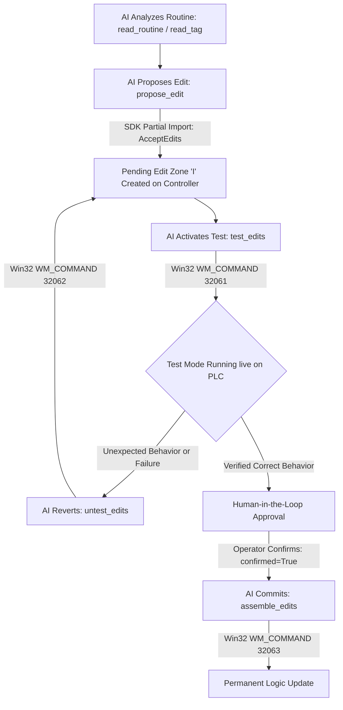

# Studio 5000 Live MCP Server

[](https://www.python.org/downloads/)
[](https://opensource.org/licenses/MIT)
[](https://www.rockwellautomation.com/)

A Model Context Protocol (MCP) server that empowers AI agents (such as Claude Desktop, Cursor, and Antigravity) to safely inspect and edit **live Relay Ladder Logic (RLL)** in Rockwell Automation's **Studio 5000 Logix Designer** while online with the physical or emulated controller.

Built upon the proven architectural patterns and verified GUI driver mechanics of [`asqi-carter/lgx-mcp`](https://github.com/asqi-carter/lgx-mcp), this server bridges the official **Rockwell Logix Designer Python SDK** (`logix_designer_sdk`) with strict, hardcoded industrial safety gates.

---

## Architecture & Online Edit Lifecycle

Editing a live controller scan in an active manufacturing facility carries zero margin for error. Rather than pushing unverified code directly into the active scan, this MCP server enforces Studio 5000's native online-edit state machine:



1. **`read_routine` & `read_tag`**: The AI inspects the existing ladder logic rungs and online process variables.
2. **`propose_edit`**: The AI stages new or replaced rungs. The server parses operands through safety gates, generates a compliant Rockwell `<RSLogix5000Content>` partial import XML fragment, and pushes it as an **Accepted Pending Edit** (`AcceptEdits`). The controller does *not* execute this logic yet.
3. **`test_edits`**: Posts Studio 5000 command `32061` to switch the controller into test mode. The new logic is scanned live while preserving the original rungs in memory.
4. **`untest_edits`**: If any anomaly is observed, command `32062` immediately reverts the controller to scanning the original rungs without interrupting machine uptime.
5. **`assemble_edits`**: Permanently finalizes the edits. **This tool requires explicit operator confirmation (`confirmed=True`) and refuses execution otherwise.**

---

## Hardcoded Industrial Safety Gates

The server hardcodes unbypassable validation rules in Python before any SDK call or logic injection is made:

### 1. Tag Safety Restrictions
* **No Safety Instrumented Tags**: Any operand or tag starting with `Safety_` (case-insensitive, e.g., `Safety_Estop`, `safety_gate`) is immediately rejected with a `PROHIBITED_SAFETY_TAG` violation.
* **No Alias Tags**: Edits targeting alias tags (`TagType="Alias"` or `AliasFor`) are denied to prevent indirect memory overwrite hazards.
* **No Consumed Tags**: Writing or editing consumed tags (`Usage="Consumed"`) is blocked because external producing controllers cyclically overwrite these values.
* **No External Access None**: Any tag configured with `ExternalAccess="None"` cannot be targeted or modified.

### 2. Routine & Language Restrictions
* **Relay Ladder Logic (RLL) Only**: Edits to Function Block Diagrams (FBD), Sequential Function Charts (SFC), or Structured Text (ST) routines are denied due to online compiler hazards.
* **No Add-On Instructions (AOIs)**: Edits to routines defining AOIs or calling user-defined AOIs are strictly prohibited to prevent AOI signature faults or online re-compilation faults.

### 3. Human-In-The-Loop Assemble Safeguard
* Calling `assemble_edits` without passing `confirmed=True` returns an immediate `REJECTED_BY_SAFEGUARD` error.

---

## Project Structure

```
studio5000-live-mcp/
├── README.md                           # Documentation and setup instructions
├── requirements.txt                    # Python dependencies
├── pyproject.toml                      # Package configuration
├── src/
│   └── studio5000_live_mcp/
│       ├── __init__.py
│       ├── server.py                   # FastMCP server & tool definitions
│       ├── sdk_client.py               # Rockwell Logix Designer SDK wrapper
│       ├── safety_validator.py         # Hardcoded safety gates & regex parser
│       ├── l5x_builder.py              # Rockwell XML Partial Import generator
│       └── win32_lifecycle.py          # Win32 WM_COMMAND driver (test/untest/assemble)
└── tests/
    ├── __init__.py
    ├── test_safety_gates.py            # Unit tests for safety gates and safeguards
    └── test_l5x_builder.py             # Unit tests for L5X generation, validation & error prevention
```

---

## Installation & Prerequisites

### 1. Requirements
* Windows 10 / 11 / Server 2022
* Python 3.12 (64-bit recommended)
* Rockwell Studio 5000 Logix Designer (v34 to v38)
* Rockwell Logix Designer SDK (installed with Studio 5000)

### 2. Setup Virtual Environment
```powershell
# Create virtual environment
python -m venv .venv
.\.venv\Scripts\Activate.ps1

# Install base requirements
pip install -r requirements.txt

# Install the official Rockwell Logix Designer SDK Python wheel
# (Located inside your Studio 5000 Logix Designer SDK directory)
pip install "C:\Users\Public\Documents\Studio 5000\Logix Designer SDK\python\logix_designer_sdk-2.0.2-py3-none-any.whl"
```

### 3. Run Safety Gate Tests
```powershell
python -m pytest tests/ -v
```

---

## AI Harness Configuration

### 1. Claude Desktop
Add the following configuration to `%APPDATA%\Claude\claude_desktop_config.json`:

```json
{
  "mcpServers": {
    "studio5000-live": {
      "command": "C:\\Users\\Krutarth Sailor\\AppData\\Roaming\\uv\\python\\cpython-3.12.16-windows-x86_64-none\\python.exe",
      "args": [
        "-m",
        "studio5000_live_mcp.server",
        "--acd-path",
        "C:\\Sonic\\PLC\\SpectrumBrands_2278_12_11_2025_A.ACD"
      ],
      "cwd": "C:\\Users\\Krutarth Sailor\\.gemini\\antigravity\\scratch\\studio5000-live-mcp",
      "env": {
        "PYTHONPATH": "C:\\Users\\Krutarth Sailor\\.gemini\\antigravity\\scratch\\studio5000-live-mcp\\src",
        "STUDIO5000_ACD_PATH": "C:\\Sonic\\PLC\\SpectrumBrands_2278_12_11_2025_A.ACD"
      }
    }
  }
}
```

---

### 2. Cursor
In Cursor, go to **Settings** &rarr; **Features** &rarr; **MCP Servers** &rarr; **Add New MCP Server**, or configure `.cursor/mcp.json` in your workspace:

```json
{
  "mcpServers": {
    "studio5000-live": {
      "command": "python",
      "args": [
        "-m",
        "studio5000_live_mcp.server",
        "--acd-path",
        "C:\\Sonic\\PLC\\SpectrumBrands_2278_12_11_2025_A.ACD"
      ],
      "cwd": "C:\\Users\\Krutarth Sailor\\.gemini\\antigravity\\scratch\\studio5000-live-mcp",
      "env": {
        "PYTHONPATH": "C:\\Users\\Krutarth Sailor\\.gemini\\antigravity\\scratch\\studio5000-live-mcp\\src",
        "STUDIO5000_ACD_PATH": "C:\\Sonic\\PLC\\SpectrumBrands_2278_12_11_2025_A.ACD"
      }
    }
  }
}
```

---

### 3. Antigravity / Gemini
Add to `~/.gemini/antigravity/mcp_config.json`:

```json
{
  "mcpServers": {
    "studio5000-live": {
      "command": "C:\\Users\\Krutarth Sailor\\.gemini\\config\\mcp\\studio5000-ai-assistant\\.venv\\Scripts\\python.exe",
      "args": [
        "-m",
        "studio5000_live_mcp.server",
        "--acd-path",
        "C:\\Sonic\\PLC\\SpectrumBrands_2278_12_11_2025_A.ACD"
      ],
      "cwd": "C:\\Users\\Krutarth Sailor\\.gemini\\antigravity\\scratch\\studio5000-live-mcp",
      "env": {
        "PYTHONPATH": "C:\\Users\\Krutarth Sailor\\.gemini\\antigravity\\scratch\\studio5000-live-mcp\\src"
      }
    }
  }
}
```

---

## Available MCP Tools

| Tool Name | Type | Description | Key Parameters |
| :--- | :--- | :--- | :--- |
| **`read_routine`** | Read | Fetches routine ladder rungs, comments, and pending states. | `program_name`, `routine_name` |
| **`read_tag`** | Read | Reads live online tag value, data type, and access flags. | `tag_name`, `program_name` *(optional)* |
| **`propose_edit`** | Write / Staged | Pushes staged ladder edits to controller as pending zone (`AcceptEdits`). | `program_name`, `routine_name`, `insert_position`, `replace_count`, `new_rungs`, `new_tags` |
| **`test_edits`** | Lifecycle | Activates Test Mode (`WM_COMMAND 32061`); controller scans new logic. | `program_name`, `routine_name` |
| **`untest_edits`** | Lifecycle | Reverts controller to original logic (`WM_COMMAND 32062`). | `program_name`, `routine_name` |
| **`assemble_edits`** | Lifecycle | Finalizes edits permanently (`WM_COMMAND 32063`). **Requires confirmation**. | `program_name`, `routine_name`, `confirmed: bool` |
| **`build_aoi_l5x`** | Generator | Generates 100% schema-compliant AOI `.L5X` file with `Use="Target"`. | `controller_name`, `aoi_name`, `parameters`, `rungs`, `output_path` |
| **`validate_l5x_file`** | Validator | Verifies `.L5X` file against Rockwell schema; catches Error 25134-80044178 and Error 5078-0 before import. | `file_path` |

---

## Git Initialization & Publishing to GitHub

To initialize this repository locally and push it to your GitHub profile (`krusailor44-afk`):

```powershell
# 1. Navigate to the project root
cd "C:\Users\Krutarth Sailor\.gemini\antigravity\scratch\studio5000-live-mcp"

# 2. Initialize Git
git init

# 3. Configure Author
git config user.name "krusailor44-afk"
git config user.email "krusailor44@gmail.com"

# 4. Add files and make initial commit
git add .
git commit -m "feat: initial commit for studio5000-live-mcp server with online edit lifecycle and safety gates"

# 5. Create the public repository on GitHub (using GitHub CLI)
gh repo create studio5000-live-mcp --public --source=. --remote=origin --push

# (OR if using standard git with an already created GitHub repo):
# git branch -M main
# git remote add origin https://github.com/krusailor44-afk/studio5000-live-mcp.git
# git push -u origin main
```

---

## License
MIT License. Developed for industrial automation safety and reliable AI-assisted PLC engineering.
